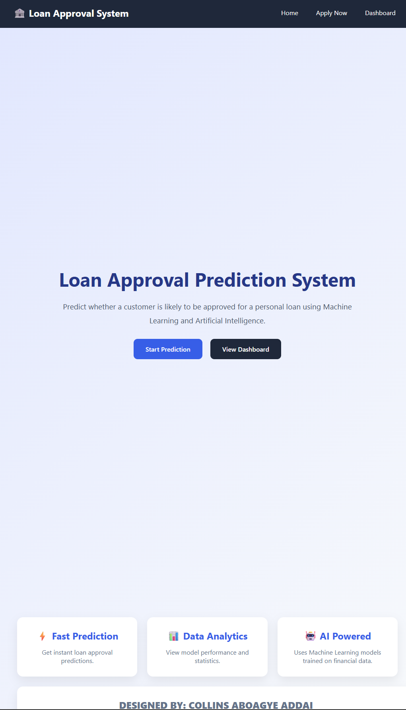
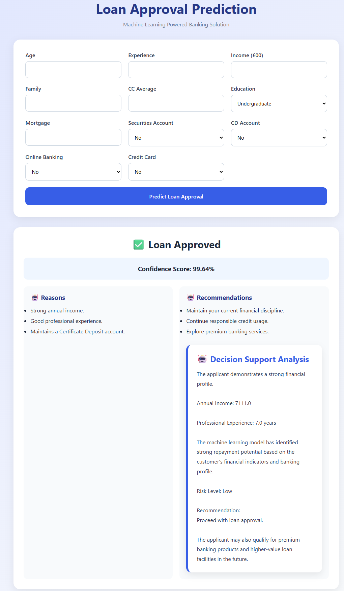
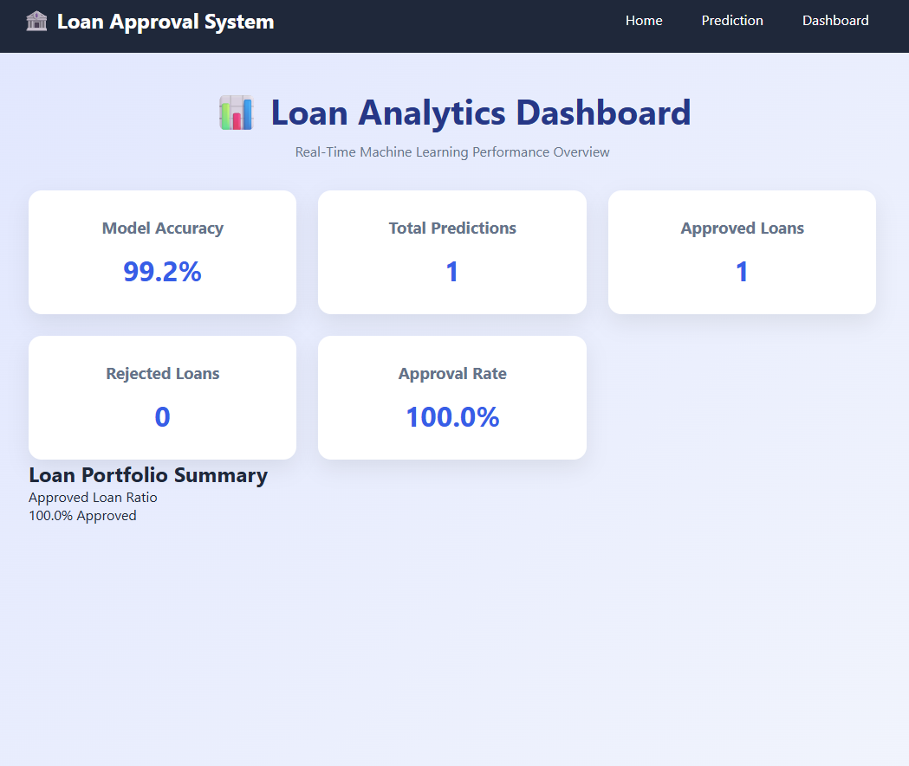

Loan Approval Prediction System
📌 Project Overview  

The Loan Approval Prediction System is an end-to-end Machine Learning application designed to predict whether a customer is eligible for a personal loan based on demographic, financial, and banking-related attributes.

The system automates the entire machine learning lifecycle, including data ingestion, data transformation, model training, hyperparameter tuning, prediction pipeline creation, and deployment using Flask.

The final model predicts loan approval status with high accuracy and provides a user-friendly web interface for real-time inference.

🎯 Business Problem  

Financial institutions receive thousands of loan applications annually. Manually reviewing every applicant can be time-consuming and costly.

This project aims to:

Reduce loan processing time
Improve decision-making consistency
Minimize financial risks
Automate customer eligibility assessment
Using machine learning, the system predicts whether a customer is likely to accept or qualify for a personal loan offer.

📊 Dataset Information

The dataset contains customer banking information such as:

Feature	Description
Age	Customer age
Experience	Years of professional experience
Income	Annual income
Family	Family size
CCAvg	Average credit card spending
Education	Education level
Mortgage	Mortgage amount
Securities.Account	Securities account status
CD.Account	Certificate Deposit account status
Online	Online banking usage
CreditCard	Credit card ownership
Personal.Loan	Target variable
Target Variable
Personal.Loan

1 = Loan Approved
0 = Loan Rejected

🛠️ Technologies Used

Programming Language
Python 3.13
Libraries
Pandas
NumPy
Scikit-Learn
Flask
Pickle
Machine Learning Algorithms
Logistic Regression
Decision Tree Classifier
Random Forest Classifier
Gradient Boosting Classifier
AdaBoost Classifier

📂 Project Structure
LAP/
│
├── app.py
│
├── artifacts/
│   ├── data.csv
│   ├── train.csv
│   ├── test.csv
│   ├── preprocessor.pkl
│   ├── model.pkl
│   └── tuned_model.pkl
│
├── src/
│   ├── logger.py
│   ├── exception.py
│   ├── utils.py
│   │
│   ├── components/
│   │   ├── data_ingestion.py
│   │   ├── data_transformation.py
│   │   ├── model_trainer.py
│   │   └── hyperparameter.py
│   │
│   └── pipeline/
│       ├── train_pipeline.py
│       └── predict_pipeline.py
│
├── templates/
│   ├── index.html
│   └── home.html
│
├── static/
│   └── style.css
│
├── requirements.txt
└── README.md

⚙️ ML Workflow
Raw Dataset
     ↓
Data Ingestion
     ↓
Data Transformation
     ↓
Feature Scaling
     ↓
Model Training
     ↓
Hyperparameter Tuning
     ↓
Model Selection
     ↓
Prediction Pipeline
     ↓
Flask Application

🤖 Model Performance
Model	Accuracy
Logistic Regression	95.50%
Decision Tree	98.80%
Random Forest	99.00%
Gradient Boosting	99.20%
AdaBoost	97.40%
Best Model
Gradient Boosting Classifier
Hyperparameter Tuning Result
Best Parameters

learning_rate = 0.1
max_depth = 3
n_estimators = 100
Cross Validation Score
98.58%

🚀 How to Run the Project
Clone Repository
git clone <repository-url>
Navigate to Project Folder
cd LAP
Install Dependencies
pip install -r requirements.txt
Train Pipeline
python -m src.pipeline.train_pipeline
Run Flask Application
python app.py
Open Browser
http://127.0.0.1:5005

🌟 Advanced Application Features

✅ Automated Data Ingestion

✅ Data Transformation Pipeline

✅ Feature Engineering

✅ Model Training Pipeline

✅ Hyperparameter Optimization

✅ Custom Logging

✅ Custom Exception Handling

✅ Prediction Pipeline

✅ Flask Web Application

✅ Responsive User Interface

✅ Model Confidence Scoring

✅ Explainable AI (XAI)

✅ Decision Support Analysis

✅ Financial Recommendation Engine

✅ Interactive Dashboard

📸 Screenshots
Home Page
![alt text]

screenshots/home_page.png
Loan Approved
![alt text]

screenshots/loan_approved.png
Loan Rejected
)

!

🤖 AI-Powered Decision Support Analysis

The system extends beyond traditional loan prediction by providing an intelligent Decision Support Analysis module.

After generating a loan approval prediction, the application analyzes key customer attributes and automatically provides:

Loan approval or rejection explanation
Confidence score
Key approval factors
Risk indicators
Personalized recommendations
Financial decision-support insights

This feature improves transparency and helps users understand the primary drivers behind the model's decision.

Example Insights
Approved Applicant

Decision: Loan Approved

Strengths:
- Strong annual income
- Good professional experience
- Positive banking profile

Risk Level:
Low

Recommendation:
Proceed with loan approval.

Rejected Applicant

Decision: Loan Rejected

Risk Factors:
- Limited professional experience
- No Certificate Deposit account

Risk Level:
Moderate to High

Recommendation:
Strengthen financial standing and
reapply in the future.

🧠 Explainable AI Features

To improve interpretability and trust, the system incorporates Explainable AI (XAI) principles through:

✅ Confidence Score Generation

✅ Decision Explanation Engine

✅ Risk-Level Assessment

✅ Customer-Specific Recommendations

✅ Automated Financial Decision Support

✅ Human-Readable Prediction Insights

This enables users and stakeholders to better understand the rationale behind loan decisions.

📊 Business Impact

The Loan Approval Prediction System provides
business value by combining predictive analytics
with decision support capabilities.

Benefits include:
• Faster customer assessment
• Improved loan approval consistency
• Increased transparency in model decisions
• Better customer guidance
• Reduced manual review effort
• Enhanced decision-making support

💡 Future Improvements
Docker Containerization
Cloud Deployment
User Authentication
Real-Time API Integration
Model Monitoring Dashboard
CI/CD Pipeline

👨‍💻 Author

Collins Aboagye Addai

Machine Learning & Data Science Engineer
MSc Big Data Candidate | University of Stirling

Skills:
• Python
• Machine Learning
• Data Analytics
• Artificial Intelligence
• Flask Development
• Predictive Modelling
• IT Support Engineering

GitHub: https://github.com/CAADDAI
LinkedIn: https://linkedin.com/in/caaddai
Email: YOUR_EMAIL

Please consider giving the repository a star.